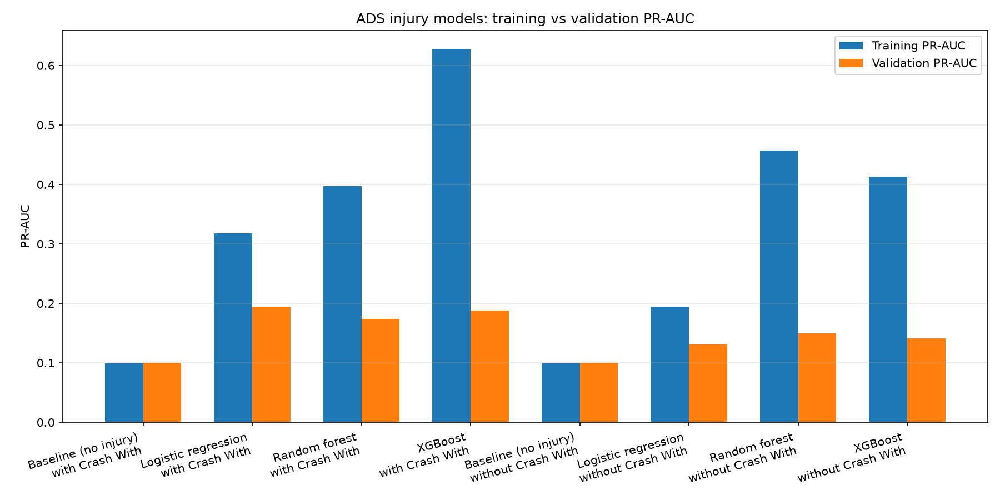

# Adding XGBoost to ADS Injury Models

This work was primarily to add XGBoost onto previous models. See models.md for setup details. 
One major difference to highlight: XGBoost uses "scale_pos_weight" instead of having a balanced weight as the other models do.

## Results
| Model | Crash With | PR-AUC (95% range) | ROC-AUC | Macro-F1 |
|---|---|---|---|---|
| Baseline | either | 0.09 | 0.50 | 0.48 |
| Logistic regression | with | **0.18** (0.12–0.26) | 0.65 | 0.49 |
| Random forest | with | 0.16 (0.12–0.23) | 0.66 | 0.50 |
| XGBoost | with | 0.18 (0.13-0.26) | 0.661 | 0.554 |
| Logistic regression | without | 0.11 (0.09–0.15) | 0.57 | 0.44 |
| Random forest | without | 0.11 (0.09–0.15) | 0.59 | 0.48 |
| XGBoost | without | 0.10 (0.08-0.15) | 0.535 | 0.515 |

## Key Takeaways:
- XGBoost did not perform better than logistic regression, but does have a distinctly different PR curve.
- Some internal tests showed that XGB had must better results on the training data vs the validation data:

- This suggests that XGB may be overfitting on the training data, so I tried playing around with some parameters such as reg_lambda and gamma, and adding more options for learning rate, max_depth, and min_child_weight, but none appeared to help as the model which was chosen to be the best actually had a worse F1 score than before (so I reverted this change because the runtime was extremely long with so many combinations of params)
- Still very limited by the size of our dataset, especially the number of injuries, even with the scaled weighting for XGBoost.
- Overall, XGBoost is at least doing similarly to logistic regression so far. 
- Note: best original params for XGB with Crash_With were: max_depth = 3, learning_rate = 0.03, 'min_child_weight' = 1.

# Level 2 work
- Kept all rows with NaN injury labels that were still valid on the other data cleaning conditons to expand the level 2 dataset.
- Built a classifier to predict dataset origination between level 2 and ADS.
    - See lv2_ads_classifier.py
    - Note that Report ID and Same Incident ID are excluded since it is likely to be able to distinguish between the encodings
    

## Level 2 Classifier Results
| Model | Validation Macro-F1 |
|---|---:|
| Majority baseline | 0.3820 |
| Logistic Regression | 0.9253 |
| Random Forest | **0.9339** |
| Extra Trees | 0.9200 |

| Class | Validation Precision | Validation Recall | Validation F1 | Validation Support | Test Precision | Test Recall | Test F1 | Test Support |
|---|---:|---:|---:|---:|---:|---:|---:|---:|
| ADS | 0.90 | 0.94 | 0.92 | 577 | 0.92 | 0.93 | 0.92 | 576 |
| Level2 | 0.96 | 0.94 | 0.95 | 934 | 0.95 | 0.95 | 0.95 | 933 |
| Macro avg | 0.93 | 0.94 | 0.93 | 1511 | 0.93 | 0.94 | 0.94 | 1509 |
| Weighted avg | 0.94 | 0.94 | 0.94 | 1511 | 0.94 | 0.94 | 0.94 | 1509 |

| Metric | Validation | Test |
|---|---:|---:|
| Accuracy | 0.94 | 0.94 |
| Macro-F1 | 0.94 | 0.94 |
| Support | 1511 | 1509 |

## Key Takeaways:
- Able to distinguish between ADS and level 2 datasets
- MAJOR PROBLEM: it is highly likely that the datasets are too sparse, especially for level 2, such that the model could just be learning that more unknowns = level 2
- I thought it could be an issue with the injury column, since I just added back in a bunch of data containing unknown injury labels, so I completely removed it from the model, and it did the exact same, meaning that there is something with the actual crash conditions.
- The data above is with the injury and date columns removed, it only does slight worse than before but still rounds to 0.94.
- Need to reconsider what we want this classifier to be really used for. 
