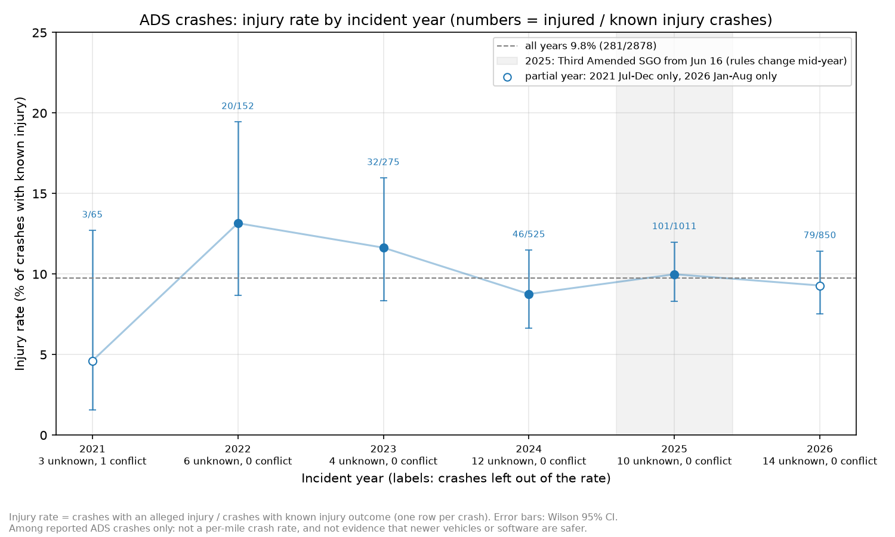
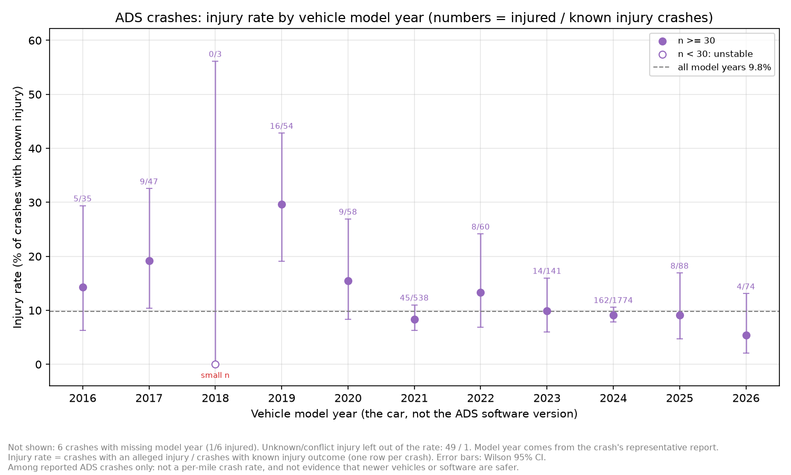
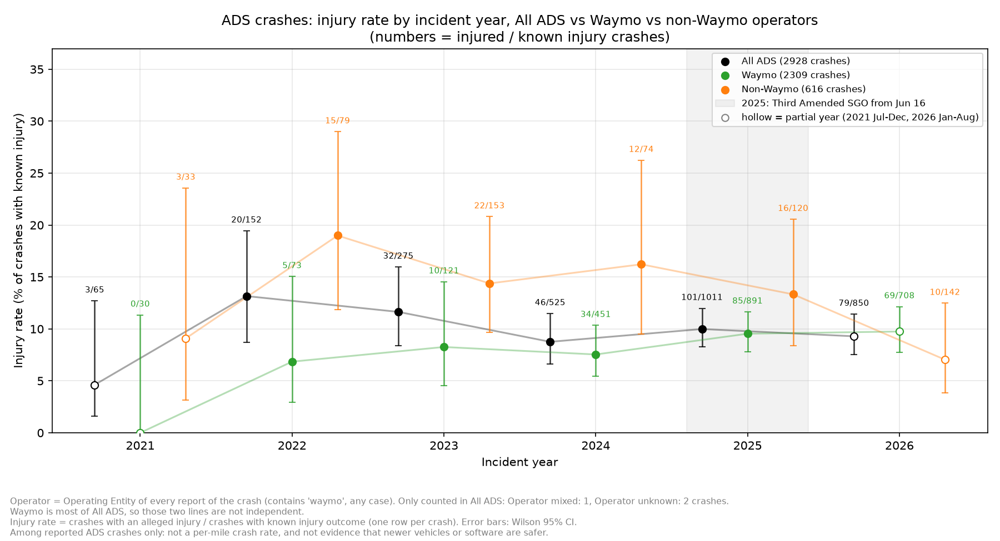

# ADS injury rate over time: incident year, model year, Waymo vs non-Waymo

Yangkai Zhou (Logan)








## Three research questions and findings

1. Did injury proportions change over time?

They fluctuated across years, but we did not identify a clear, consistent downward trend. The proportion was approximately 13.2% in 2022 and 9–10% during 2024–2026. No formal statistical trend test was performed.

2. Do newer vehicle model years show lower injury proportions?

Not consistently. Model years 2021 and 2024 account for most of the data, with similar injury proportions of 8.4% and 9.1%. Older model years sometimes appear higher, but have smaller samples and different operator compositions.

3. How does Waymo compare with other operators?

Among reported crashes with known injury outcomes, Waymo had an injury proportion of 8.9%, compared with 13.0% for non-Waymo operators.

Waymo also accounts for most ADS crash records from 2024 onward, which helps explain why the overall ADS trend closely follows Waymo's trend.

All three are about crashes that were already reported. There's no mileage data, so this is not a crash rate per mile and it can't show that newer cars or software are safer.

## Main takeaway

The data show differences in injury proportions across years, vehicle model years, and operators, but these differences do not establish that newer ADS technology or a particular company is safer.

The dataset contains reported crashes rather than total driving exposure. Reporting rules, operating environments, and operator composition also differ.

These figures are descriptive EDA findings, not machine learning model performance results.

### Which Figures to Present

| Figure | What It Shows | Main Finding |
|---|---|---|
| **Injury Rate by Incident Year** | Injury proportions across incident years (2021–2026) | Injury proportions fluctuate over time, with no clear, consistent downward trend. |
| **Injury Rate by Model Year** | Injury proportions across vehicle model years | Newer vehicle model years do not consistently show lower injury proportions. Model year does not represent ADS software version. |
| **Waymo vs. Non-Waymo** | Annual injury proportions for All ADS, Waymo, and non-Waymo | Waymo's growing share of reported ADS crashes influences the overall trend. Differences between operators do not establish safety differences. |

## How to run

```
python scripts/eda_time_trends.py
```

Same script as the monthly counts (`docs/time_trends.md`), the injury rate part is added at the end. The monthly csv files and plots don't change.

## Definitions

- One row per ADS crash, same crash table as the monthly crash counts (same rules as Justin's `clean_ads.py`: ADS filter, latest Report Version, one crash per Same Incident ID, report with known injury and more complete fields picked first).
- Injury label: Justin's `injury_map`. Each crash is exactly one of:
  - **injured** / **non-injured**: the reports have a known injury and agree.
  - **unknown**: no report of the crash has a known injury (all "Unknown").
  - **conflict**: the reports disagree (injury vs no injury).
- **Injury rate = injured / (injured + non-injured)**. Unknown and conflict are counted in the tables but not in the rate. `ads_model.csv` drops both, so the known-injury numbers are the same as `ads_model.csv`.
- 95% CI: Wilson interval. Groups with fewer than 30 known-injury crashes are marked `small_sample` (same cutoff as `eda_injury_rates.py`).
- **Incident year**: year of the Incident Date. 2021 is Jul-Dec only, 2026 is Jan-Aug only. 2025 has reports under the old SGO (archive file, to Jun 13) and the Third Amended SGO (current file, from Jun 16).
- **Model year**: the vehicle model year from the crash's representative report (the same value as Justin's `prepare_ads_model.py`). It's the year of the car, not the ADS software version. Missing model year is its own group "Unknown".
- **Operator**: from the Operating Entity of every report of the crash, matching "waymo" ignoring case (it's written 7 ways, like "Waymo LLC", "Waymo, LLC.", "WAYMO LLC"). Operating Entity is used, not Reporting Entity, because Transdev files reports for Waymo cars (133 Waymo crashes have a Transdev report).
  - Waymo: all reports say Waymo. Non-Waymo: no report says Waymo.
  - Operator mixed: some reports say Waymo and some say something else. Operator unknown: Operating Entity is empty.
  - Mixed and unknown are only counted in All ADS, not in Waymo or Non-Waymo.

## Numbers

Incident year (`results/time_trends/injury_rate_by_incident_year.csv`):

| year | crashes | known | injured | unknown | conflict | injury rate | 95% CI |
|---|---|---|---|---|---|---|---|
| 2021 (Jul-Dec) | 69 | 65 | 3 | 3 | 1 | 4.6% | 1.6-12.7% |
| 2022 | 158 | 152 | 20 | 6 | 0 | 13.2% | 8.7-19.5% |
| 2023 | 279 | 275 | 32 | 4 | 0 | 11.6% | 8.4-16.0% |
| 2024 | 537 | 525 | 46 | 12 | 0 | 8.8% | 6.6-11.5% |
| 2025 | 1021 | 1011 | 101 | 10 | 0 | 10.0% | 8.3-12.0% |
| 2026 (Jan-Aug) | 864 | 850 | 79 | 14 | 0 | 9.3% | 7.5-11.4% |
| all | 2928 | 2878 | 281 | 49 | 1 | 9.8% | 8.7-10.9% |

Model year (`results/time_trends/injury_rate_by_model_year.csv`), groups with 100+ known-injury crashes:

| model year | known | injured | injury rate | 95% CI |
|---|---|---|---|---|
| 2021 | 538 | 45 | 8.4% | 6.3-11.0% |
| 2023 | 141 | 14 | 9.9% | 6.0-16.0% |
| 2024 | 1774 | 162 | 9.1% | 7.9-10.6% |

The other model years have 35-88 known crashes each (2018 only 3, and Unknown 6), see the csv.

Operator (`results/time_trends/injury_rate_waymo_vs_all_by_year.csv`), all years:

| group | crashes | known | injured | injury rate | 95% CI |
|---|---|---|---|---|---|
| All ADS | 2928 | 2878 | 281 | 9.8% | 8.7-10.9% |
| Waymo | 2309 | 2274 | 203 | 8.9% | 7.8-10.2% |
| Non-Waymo | 616 | 601 | 78 | 13.0% | 10.5-15.9% |
| Operator mixed | 1 | 1 | 0 | - | - |
| Operator unknown | 2 | 2 | 0 | - | - |

Waymo share of ADS crashes: 44-49% in 2021-2023, 83-88% in 2024-2026.

## What we see

- **Incident year:** 2022-2023 are a bit higher (13%, 12%) and 2024-2026 are around 9-10%. The year-to-year changes are small next to the 95% intervals, so the data doesn't show a clear trend. I didn't run a significance test, and overlapping intervals alone don't prove there's no difference. 2021 (4.6%) is only 3 injuries in 6 months.
- **Model year:** almost all crashes are model year 2021 or 2024 (mostly Waymo vehicles), and those two are about the same (8.4% vs 9.1%). Older model years (2016-2020) look higher, like 2019 at 30% (16/54), but they're small groups and mostly other operators, so model year is mixed up with which company and which years. Model year is the year of the car, so it doesn't tell us which ADS software version was driving. Model year 2018 (0/3) is too small to say anything.
- **Waymo vs non-Waymo:** over all years Waymo's injury rate among reported crashes is lower (8.9% vs 13.0%, the intervals don't overlap). By year, Waymo goes from 6.9% (2022) to 9.5-9.8% (2025-2026) and non-Waymo goes from 19.0% (2022) to 7.0% (2026 Jan-Aug), but the yearly intervals are wide, especially for non-Waymo, so the yearly changes are uncertain.
- Since 2024 Waymo is most of All ADS, so the All ADS line mostly follows Waymo.
- These are differences in which reported crashes involve an injury, not in how safe each company is. Without mileage we don't know how often each fleet crashes, and the gap can come from where and how the cars drive (city, speed, crash partner), which companies are in each group (non-Waymo changes a lot over the years), and how each company reports.

## Partial years and the 2025 rule change

- 2021 (Jul-Dec) and 2026 (Jan-Aug) don't cover the full year, so their rates come from fewer crashes and may have a different season mix. The last months of 2026 can still get late reports or updated injury severity in future NHTSA releases.
- In 2025 the reports come from two versions of the SGO: the archive file up to Jun 13 and the Third Amended SGO from Jun 16, with a different report form (for example, new injury categories split by hospitalization). Both are mapped to the same 0/1 label, but changes in what gets reported and how injury is recorded can move the rate, so years before and after mid-2025 aren't fully comparable.

## Data quality

- **Conflict crash:** 1 crash (Same Incident ID `2be0d6e1e9a8d23`, Waymo, OCT-2021) has 3 reports: "Minor" and 2x "No Injuries Reported". The crash table keeps a "No Injuries" report for it, so in my first numbers it was counted as non-injured. Now it's in the conflict column and not in the rate. No conflict crashes in the current file.
- **Missing model year (6 crashes):** Beep / Navya / Local Motors shuttles (2022-2024) and a Mercedes EQS (2022, reports from Mercedes and Bosch). Kept as "Unknown".
- **Model year after incident year (22 crashes):** all exactly 1 year after (e.g., Tesla Model Y 2026 and Zoox 2026 in 2025, Cruise 2023 in Dec 2022). This is normal for new model years, so they're kept.
- **Reports with different model years (1 crash):** `8e7e78cafabfc2e`, Waymo Zeekr, Apr 2025: Waymo's report says 2023, Transdev's says 2024. The representative report is Waymo's (2023), same as in Justin's `validate.csv`.
- **Different representative report than ads_model.csv (10 crashes):** ties in the sort. Injury and incident month are the same either way, and none of the 10 has a different model year, so the tables don't change.
- **Operator:** 1 mixed crash (`b90c9dd7320e24f`, Nov 2021): 2 reports say "Waymo LLC" and 1 Waymo report says "5th Generation ADS". It's most likely Waymo, but I didn't guess, it's only in All ADS. 2 crashes have no Operating Entity (NAVYA Arma 2021, Local Motors 2023).

## Checks

All in `results/time_trends/injury_rate_checks.csv`, the script stops if one fails:

- 2928 crashes (same as `data_quality_summary.csv`), 2878 known, 49 unknown, 1 conflict, crash ids unique.
- Every row: known + unknown + conflict = total, injured + non-injured = known, rate = injured / known, rate inside the CI.
- Years and model years (with Unknown) add up to the all row.
- Each crash is in exactly one operator group, and the groups add up to All ADS.
- Known and injured per year are the same as `ads_model.csv`.
- Model year is the same as in Justin's train/validate/test files for the 2868 crashes with the same report.
- Monthly csv files and plots are the same as before, and two runs give the same csv files.

## Limitations

- No mileage, so no crash rates and no "safer" claims.
- Injury is alleged by the company and not checked.
- 2021 and 2026 are partial years, and the SGO rules changed in June 2025.
- Same Incident ID isn't shared between the archive and current files, so a 2025 crash reported in both would count twice (no shared Report IDs, but I can't fully check it).
- Model year, incident year and operator are all mixed together (e.g., Waymo's 2024 cars show up mostly in 2025-2026 crashes).

## File locations

Code: `scripts/eda_time_trends.py`  
Tables: `results/time_trends/injury_rate_by_incident_year.csv`, `injury_rate_by_model_year.csv`, `injury_rate_waymo_vs_all_by_year.csv`, `injury_rate_checks.csv`  
Charts: `docs/figures/injury_rate_by_incident_year.png`, `injury_rate_by_model_year.png`, `injury_rate_waymo_vs_all.png`
