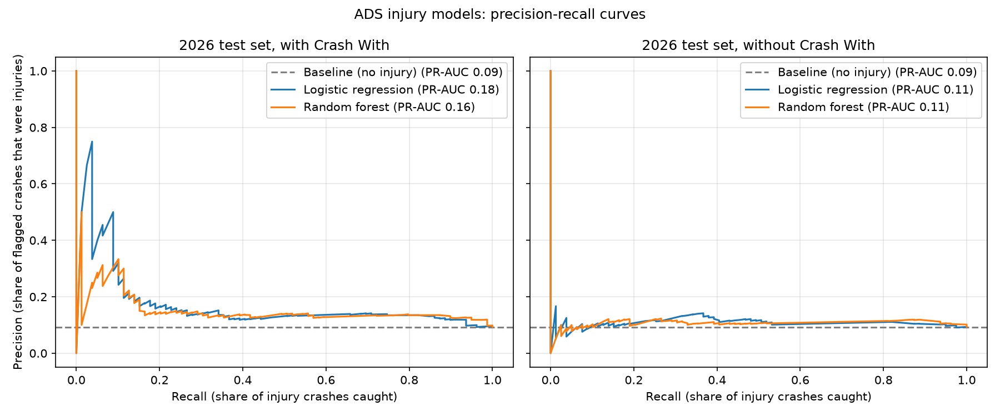
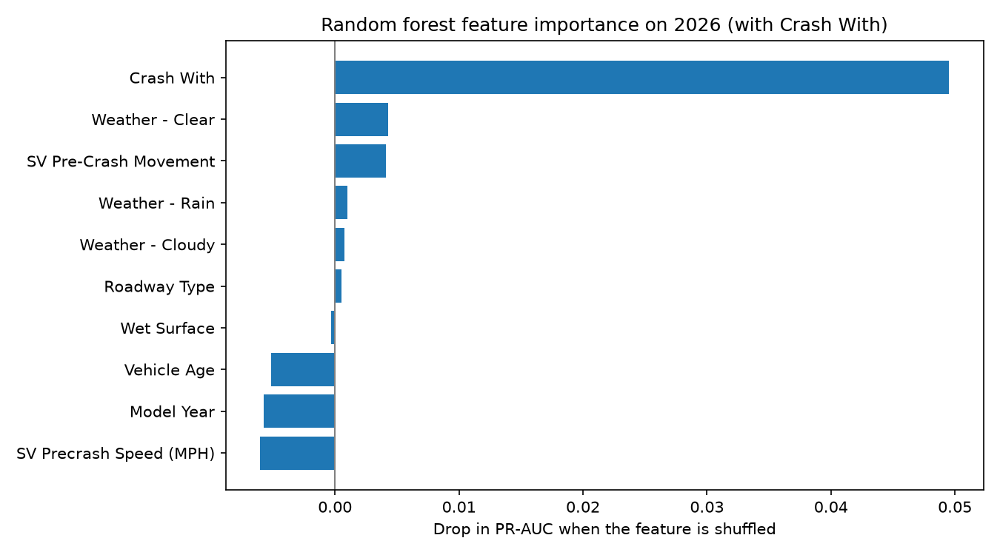

# ADS injury models

Results from `scripts/train_models.py`. Models use the input prep in `scripts/model_features.py`.

## Setup

- **Models:** baseline ("no injury"), logistic regression, and random forest, each with and without Crash With. Both real models use class weighting because only about 10% of crashes involve an injury.
- **Tuning:** trained on archives 2021–2024, settings picked by PR-AUC on 2025.
- **Final test:** retrained on 2021–2025 and scored once on 2026 (850 crashes, 79 injuries).
- **Metrics:** PR-AUC (main), ROC-AUC, and macro-F1 at a 50% cutoff. Because the test set has only 79 injuries, PR-AUC also has a 95% range from resampling the test crashes.

## Results (2026 test set)

| Model | Crash With | PR-AUC (95% range) | ROC-AUC | Macro-F1 |
|---|---|---|---|---|
| Baseline | either | 0.09 | 0.50 | 0.48 |
| Logistic regression | with | **0.18** (0.12–0.26) | 0.65 | 0.49 |
| Random forest | with | 0.16 (0.12–0.23) | 0.66 | 0.50 |
| Logistic regression | without | 0.11 (0.09–0.15) | 0.57 | 0.44 |
| Random forest | without | 0.11 (0.09–0.15) | 0.59 | 0.48 |

## What the plots show

### Precision-recall curves

- The gray dashed line is the baseline, picking crashes at random, about 9% of flagged crashes are injuries.
- **With Crash With (left):** the crashes each model ranks as riskiest are injuries far more often than 9% (up to 75% for logistic regression and about 33% for random forest, while catching the first 4–10% of injuries). As the models try to catch more injuries, precision settles around 13–15%, still above the baseline.
- **Without Crash With (right):** both curves stay just above the baseline, so the remaining conditions add little.
- The jagged lines are expected with only 79 injuries in the test set.

### Feature importance (random forest, with Crash With)

- Each bar is how much PR-AUC drops on 2026 when that feature's values are shuffled; a bigger drop means the model relies on it more.
- **Crash With dominates** (about 0.05 drop); pre-crash movement and clear weather help slightly.
- **Speed, model year and vehicle age have small negative values,** so they did not help on 2026.

## Analysis

- **With Crash With, both models beat the baseline.** Logistic regression roughly doubles it (0.18 vs. 0.09), and the low end of its range (0.12) is still above the baseline.
- **Logistic regression and random forest are effectively tied.** Their ranges overlap. With about 200 injury crashes to learn from, the random forest's extra flexibility doesn't pay off.
- **Without Crash With, the models are not reliably better than the baseline.** This is consistent with the EDA finding that road type, and speed and weather barely change injury rates.
- **Macro-F1 barely moves** because it uses one 50% cutoff, which is a poor cutoff for a rare outcome. PR-AUC covers all cutoffs, which is why it is the main metric.

## Limitations

- Crash With is partly a reporting effect, since hitting a cyclist or pedestrian is itself a reason a crash gets reported.
- The test set is small (79 injuries), so differences of a few points are within noise.
- 2026 only runs through August.
- Model year and vehicle age may not carry over to newer years; worth testing the models without them.

## File locations
Code: `scripts/train_models.py`  
Results: `results/models/model_results.csv`, `results/models/rf_feature_importance.csv`  
Charts: `docs/figures/pr_curves.png`, `docs/figures/rf_feature_importance.png`
