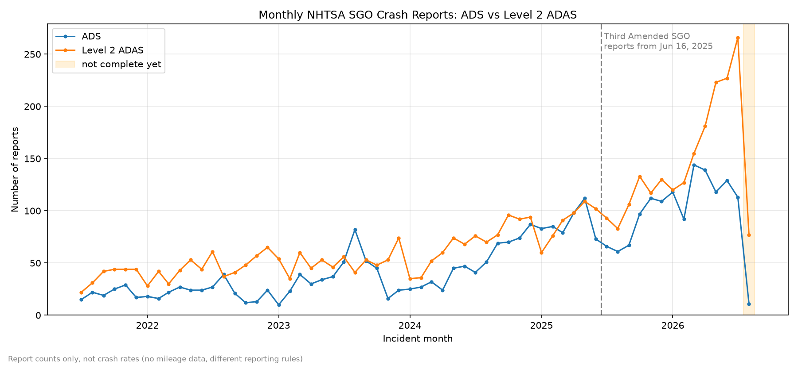

# Crash report trends over time (ADS vs Level 2 ADAS)

Yangkai Zhou (Logan)



## Goal

Look at how the number of SGO crash reports changes by month, for ADS and Level 2 ADAS separately.
These are report counts, not crash rates. We don't have miles driven and the two groups have different reporting rules, so this can't tell which system is safer.

## How to run

```
pip install -r requirements.txt
python scripts/eda_time_trends.py
```

It reads the 4 csv files in data/raw and writes:
- results/time_trends/monthly_report_counts.csv
- results/time_trends/data_quality_summary.csv
- docs/figures/monthly_report_counts.png

## Data and steps

I used ADS_archive, ADS_current, ADAS_archive and ADAS_current. ADS or Level 2 just comes from which file the report is in.

1. Combine archive and current, then keep only the latest Report Version of each Report ID. This has to be done after combining, because 37 Level 2 Report IDs have old versions in archive and newer versions in current.
2. Use the Incident Date (month and year only) of the latest version.
3. Drop reports with no Incident Date (ADS 1, Level 2 19).
4. The monthly counts start from 2021-07, when the SGO started. 22 Level 2 reports are about crashes from 2019-08 to 2021-06. They are not in the monthly counts but are listed in the quality summary.
5. Count reports per month. Months with no reports are 0.

I did not merge reports by Same Incident ID. The main number is reports. Also the Same Incident ID is different between archive and current for the same report, so crashes can't be matched across the two files. I only count incidents inside each file as a check.

The dashed line is June 16, 2025. From the NHTSA data dictionaries (in docs/), archive has reports received up to June 13, 2025 and current has Third Amended SGO reports received from June 16, 2025. Note this is a submission date, but the x axis is incident month.

The last month (2026-08) is shaded because reports for it are still coming in.

## Numbers

| | ADS | Level 2 ADAS |
|---|---|---|
| raw rows | 3773 | 6340 |
| old versions removed | 437 | 1501 |
| report ids (latest version) | 3336 | 4839 |
| no incident date | 1 | 19 |
| before 2021-07 | 0 | 22 |
| in monthly counts | 3335 | 4798 |
| incidents inside each file (check only) | 2956 | 4826 |

Reports per year:

| year | ADS | Level 2 ADAS |
|---|---|---|
| 2021 (Jul-Dec) | 127 | 227 |
| 2022 | 267 | 549 |
| 2023 | 443 | 618 |
| 2024 | 592 | 830 |
| 2025 | 1042 | 1198 |
| 2026 (Jan-Aug) | 864 | 1376 |

## What we see

- Both lines go up. For Jan-Jul, ADS went from 596 (2025) to 853 (2026) and Level 2 from 629 to 1299.
- Level 2 is higher most months. They are close from late 2024 to mid 2025, then Level 2 goes up fast in 2026 (peak 266 in 2026-07).
- ADS peak is 144 in 2026-03. There is a drop after June 2025 (289 in Mar-May vs 194 in Jul-Sep) and it comes back from Oct 2025.
- Who reports changes a lot. Waymo has 44 ADS reports in 2021 and 899 in 2025. Cruise and GM have 112 each in 2023 and almost none after 2024. Tesla is most of Level 2 every year.
- In 2021-2023 about 70-82% of ADS reports belong to a crash with more than one report (often Cruise and GM both report the same crash). After 2024 this is much lower. So early ADS report counts are higher than the real number of crashes.

## Possible reasons (not tested)

- More robotaxis and more Level 2 cars on the road could explain the growth. It does not mean the cars are getting less safe.
- The ADS drop in mid 2025 is at the same time as the switch to the Third Amended SGO. I didn't check if the new rules changed what ADS crashes need to be reported, so it's not "fewer crashes".
- ADS vs Level 2 lines can't be compared for safety (different rules, fleet size, how companies find out about crashes).

## Limitations

- Report counts, not crash counts, and no mileage data.
- Reporting rules are different for ADS and Level 2 and changed over time. Only the June 2025 change is marked. There was also a Second Amended SGO in May 2023 that is not marked.
- Dates are month only.
- Recent months can still get late reports. About 99% of ADS and 94% of Level 2 reports are submitted within 1 month of the crash month, so only the last month is shaded.
- ADS / Level 2 label comes from the file, I didn't fix mislabels. 39 ADS and 207 Level 2 reports have an "Automation System Engaged?" value that doesn't match the file (mostly Unknown).
- Results are for the current files in data/raw. A newer NHTSA release will change the recent months.


## TODO:
- Double check the reporting delay and incomplete months.
- Check the June 2025 SGO change note.
- Update the charts if the cleaned data changes.

## file location 
Code: `scripts/eda_time_trends.py`  
More details: `docs/time_trends.md`
