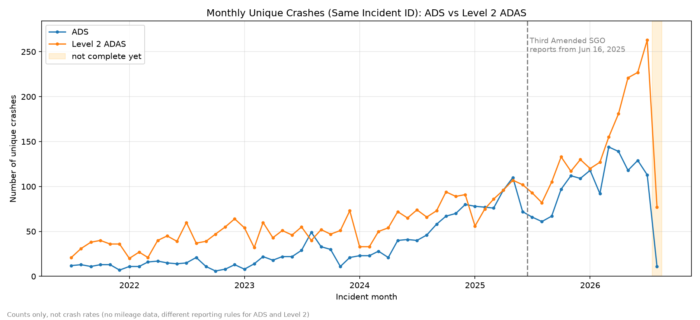

# Crash trends over time (ADS vs Level 2 ADAS)

Yangkai Zhou (Logan)




## What this is

Monthly counts of SGO reports and unique crashes, ADS and Level 2 separately.
It's just counts, not crash rates. No mileage data and the reporting rules are different, so it can't say which one is safer.

We count both because one crash can have several reports (like operator + manufacturer both report it). Early ADS data has a lot of this.

## How to run

```
pip install -r requirements.txt
python scripts/eda_time_trends.py
```

Use Python 3.12 or 3.13 (on my laptop Windows blocked numpy for 3.15).

Outputs go to results/time_trends/ (csv) and docs/figures/ (png).

## What I did

- Read the 4 raw files in data/raw.
- Same rule as Justin's clean_ads.py: keep rows where "Automation System Engaged?" is "ADS" (ADS files) or "ADAS" (Level 2 files). Matthew's script isn't in yet, so Level 2 uses the same idea for now.
- Keep the latest version of each Report ID. One Report ID = one report.
- Crashes: reports with the same Same Incident ID in the same file = one crash. Pick one report the same way clean_ads.py does. No incident ID = its own crash.
- Month = Incident Date. Start from 2021-07. A few Level 2 ones with no date (8) or before 2021-07 (14) are left out, the numbers are in data_quality_summary.csv.
- Last month (2026-08) is shaded because late reports are still coming.

I didn't use ads_model.csv as input since it's one row per crash and drops unknown injury, so no report counts and no Level 2. But I checked against it: with the same model rules I get the same 2878 ADS crashes (results/time_trends/ads_model_comparison.csv).

## Numbers

| year | ADS reports | ADS crashes | Level 2 reports | Level 2 crashes |
|---|---|---|---|---|
| 2021 (Jul-Dec) | 122 | 69 | 202 | 202 |
| 2022 | 254 | 158 | 496 | 494 |
| 2023 | 433 | 279 | 604 | 604 |
| 2024 | 585 | 537 | 795 | 794 |
| 2025 | 1039 | 1021 | 1185 | 1182 |
| 2026 (Jan-Aug) | 864 | 864 | 1376 | 1371 |

## What we see

- Both go up a lot. Jan-Jul crashes: ADS 575 -> 853, Level 2 615 -> 1294 (2025 vs 2026).
- Level 2 reports and crashes are almost the same.
- ADS had lots of double reports before 2024 (1.77 reports per crash in 2021), so the report chart makes early ADS look bigger than it was.
- ADS dropped after June 2025 and came back from Oct 2025. That's when the Third Amended SGO started (dashed line), but I didn't check if the rules caused it.
- More robotaxis and Level 2 cars on the road could explain the growth. Doesn't mean they got less safe.

## Limitations

- No mileage, so no rates.
- Different reporting rules for ADS and Level 2, and the rules changed over time.
- Crashes are only matched inside one file, Same Incident ID changes between archive and current.
- Level 2 rule not checked with Matthew yet.
- Dates are month only, and new NHTSA releases will change the recent months.


## TODO:
- Double check the reporting delay and incomplete months.
- Check the June 2025 SGO change note.
- Update the charts if the cleaned data changes.
- Check Level 2 rule with Matthew's script.

## file location 
Code: `scripts/eda_time_trends.py`  
More details: `docs/time_trends.md`
